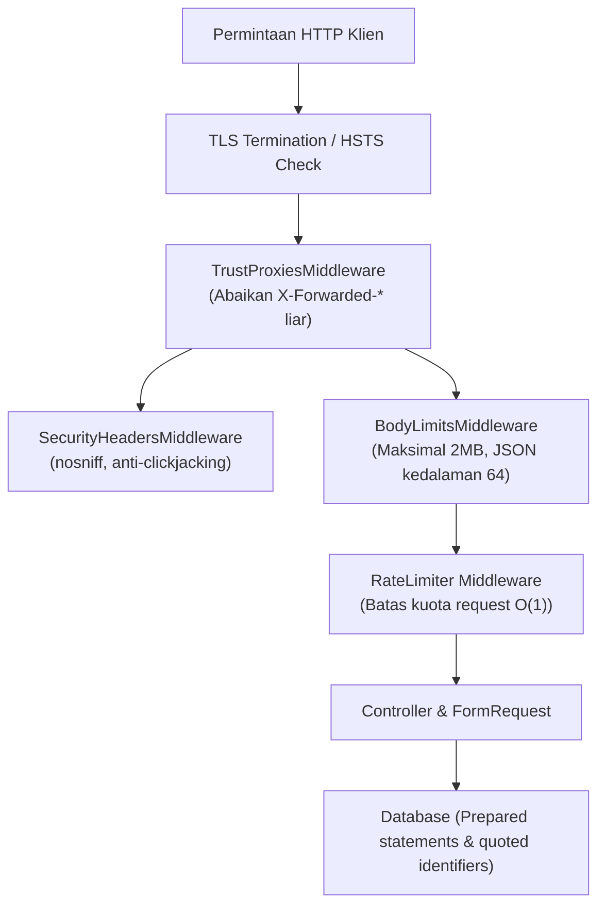

# Keamanan Sistem (Security Guide)

Pelaporan kerentanan keamanan secara privat dijelaskan pada berkas
[SECURITY.md](https://github.com/daravel-dev/daravel/blob/main/SECURITY.md).

Daravel dirancang dengan arsitektur **Secure-by-Default** dan prinsip *defense-in-depth*. Daravel tidak membebankan konfigurasi keamanan rumit kepada developer secara manual; sistem secara otomatis menegakkan batasan keamanan sejak tahap kompilasi, saat server *booting*, hingga pada setiap siklus request HTTP.

---

## Standar Keamanan Bawaan (Secure by Default)

| # | Fitur Keamanan | Perilaku Bawaan | Komponen Penegak |
| :-- | :-- | :-- | :-- |
| 1 | **Production Debug Guard** | `APP_DEBUG=true` pada `APP_ENV=production` otomatis menghentikan server saat booting | `ConfigValidator` |
| 2 | **Kekuatan Kunci Enkripsi** | `APP_KEY` wajib 32 byte (`base64:...`) untuk AES-256; kunci lemah langsung ditolak | `Encrypter` |
| 3 | **CORS Lockdown** | Menolak seluruh origin liar secara default; wildcard `*` dengan kredensial ditolak keras | `CorsMiddleware` |
| 4 | **Header Keamanan HTTP** | Memasang `X-Content-Type-Options: nosniff`, `Referrer-Policy`, `X-Frame-Options: DENY` (hanya untuk HTML), dan HSTS pada HTTPS | `SecurityHeadersMiddleware` |
| 5 | **Isolasi Header Bersih (v1.4.1)** | Menghapus default header `dart:io` dan mengganti nilai per-request agar tidak terjadi akumulasi header berulang | `ServerEngine`, `Response` |
| 6 | **Pencegahan Abuse & Brute Force** | Starter template membatasi login (5x/menit per email + IP) dan register (5x/menit per IP) | `bootstrap/app.dart` |
| 7 | **Sanitasi Log Audit** | Redaksi otomatis pada password, token, dan data rahasia; request body tidak pernah dicatat mentah ke stdout | `Logger` |
| 8 | **Proteksi File Upload** | Tipe MIME dibaca dari *magic bytes* konten asli (bukan ekstensi file), blokir file PHP, batasan ukuran, dan pembersihan file temporer | `detectMimeType`, `normalizeDiskPath` |
| 9 | **Pencegahan User Enumeration** | Pesan error autentikasi generik; akun yang tidak ditemukan tetap memicu kalkulasi hash tiruan (*dummy hash*) | `HashManager.equalizeLoginTiming` |
| 10 | **Audit Kesiapan Produksi** | Perintah `dartisan doctor --production` memeriksa konfigurasi sebelum aplikasi dirilis | `dartisan_cli` |



---

## Perlindungan Terhadap Pemalsuan IP (Anti-IP Spoofing)

Saat berjalan di balik reverse proxy (seperti Google Cloud Run, AWS ALB, Nginx, atau Traefik), penyerang sering kali mencoba menyuntikkan header palsu `X-Forwarded-For` untuk melewati batas *rate limiting* atau memanipulasi geolokasi.

Daravel **secara ketat mengabaikan** header `X-Forwarded-*` secara default:
```dart
String get ip => _forwardedIp ?? remoteAddress;
```
Agar aplikasi mengenali IP klien asli melalui proxy yang sah, pasang `TrustProxiesMiddleware` dengan daftar blok IP subnet yang terpercaya:

```dart
// bootstrap/app.dart
middleware.use([
  TrustProxiesMiddleware(proxies: [
    '10.0.0.0/8',
    '172.16.0.0/12',
    '192.168.0.0/16',
  ]),
]);
```
Setiap request yang datang di luar daftar `proxies` terpercaya akan diabaikan header `X-Forwarded-*`-nya, menjaga akurasi kuota *rate limiter* dan catatan audit.

---

## Perbaikan Isolasi Header Respons (v1.4.1)

Pada `dart:io` standar, instance `HttpServer` memulai setiap respons dengan menyalin map default header secara dangkal. Memanggil `response.headers.add()` pada server standar dapat mengakibatkan nilai header bertambah terus-menerus (`nosniff, nosniff, nosniff...`).

Pada Daravel `1.4.1`:
1. **Pembersihan Header Bawaan**: Server membersihkan `server.defaultResponseHeaders.clear()` saat *bind* socket.
2. **Semantik Ganti Nilai (*Replace*)**: `Response.writeTo()` memanggil `out.headers.removeAll(key)` sebelum menambahkan nilai baru.
3. **Pemisahan Konteks Format**: Header `X-Frame-Options` hanya disertakan pada halaman HTML; respons JSON API tidak lagi terkena polusi header frame yang tidak relevan.
4. **Penghapusan Header Usang**: Header usang seperti `X-XSS-Protection` tidak lagi dikirimkan sesuai anjuran OWASP modern.

---

## Standar Kriptografi & Ketahanan Timing Attack

### Enkripsi Terotentikasi (Authenticated Encryption)
Class `Encrypter` di Daravel menggunakan skema **Encrypt-then-MAC** (`AES-256-CBC` + `HMAC-SHA256`) atau `AES-256-GCM` dengan authentication tag 128-bit:
* Komparasi MAC menggunakan fungsi **`constantTimeEquals(expected, actual)`** guna memitigasi serangan berbasis perbedaan waktu eksekusi (*timing attack*).
* IV dan Nonce dibuat menggunakan **`Random.secure()`** (CSPRNG tingkat OS).
* Mendukung rotasi kunci tanpa *downtime* melalui variabel `APP_PREVIOUS_KEYS`.

### Dummy Hash Timing Equalizer
Jika pengguna mencoba login dengan email yang tidak terdaftar, Daravel tetap menjalankan kalkulasi hash `bcrypt` tiruan. Hal ini memastikan waktu pemrosesan antara email yang ada dan yang tidak ada tetap sama (variasi di bawah 15 ms), mencegah penyerang melakukan *user enumeration*.

---

## Suite Pengujian Keamanan Terotomatisasi

Suite pengujian regresi keamanan Daravel dieksekusi pada setiap commit dan telah meraih **kelulusan 100% pada 38 vektor uji standar industri (OWASP API Security Top 10 & CWE Top 25)**:

* **SQL Injection**: Payload SQLi OWASP ditolak dengan aman oleh layer validasi `FormRequest` dan *parameter binding*.
* **HTTP Parameter Pollution**: Parameter URL duplikat dan injeksi *null-byte* (`%00`) ditangani bersih tanpa crash.
* **Verb Tampering**: Verba HTTP berisiko (`TRACE`, `TRACK`, `CONNECT`, `DEBUG`, `PURGE`) ditolak dengan status `405 Method Not Allowed`.
* **JSON Bomb & ReDoS**: Kedalaman JSON dibatasi maksimal 64 tingkat, payload dibatasi 2 MB, dan regex divalidasi berskala linear $O(n)$.
* **Isolasi Konkurensi**: Request paralel simultan berjalan terisolasi penuh di dalam lingkup Dart `Zone` tanpa kebocoran state.

Jalankan suite uji keamanan secara lokal:
```bash
cd packages/daravel && dart test --tags security
```
