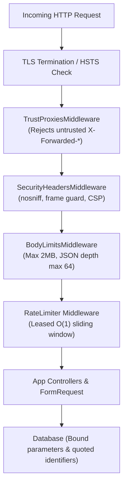

# Security

Report vulnerabilities privately as described in
[SECURITY.md](https://github.com/daravel-dev/daravel/blob/main/SECURITY.md).

Daravel is built with a **secure-by-default, defense-in-depth architecture**. Rather than requiring developers to manually remember security best practices, the framework enforces safe defaults at compilation, boot time, and request lifecycle boundaries.

---

## Secure by default (BLUEPRINT_V2 §9.2)

| # | Security Feature | Default Behavior | Enforcing Component |
| :-- | :-- | :-- | :-- |
| 1 | **Production Debug Guard** | `APP_DEBUG=true` combined with `APP_ENV=production` halts boot immediately | `ConfigValidator` |
| 2 | **Cryptographic Key Strength** | `APP_KEY` must be exactly 32 bytes (AES-256); weak/short keys are rejected | `Encrypter` |
| 3 | **CORS Lockdown** | Rejects all origins by default until explicitly whitelisted; wildcard `*` with credentials is refused | `CorsMiddleware` |
| 4 | **HTTP Security Headers** | Injects `X-Content-Type-Options: nosniff`, `Referrer-Policy`, `X-Frame-Options: DENY` (HTML only), and HSTS on HTTPS | `SecurityHeadersMiddleware` |
| 5 | **Strict Header Isolation (v1.4.1)** | Clears `dart:io` default headers and replaces values per response to prevent cross-request header accumulation | `ServerEngine`, `Response` |
| 6 | **Abuse & Rate Limiting** | Starter template throttles `login` (5/min per e-mail + IP) and `register` (5/min per IP) | `bootstrap/app.dart` |
| 7 | **Audit Log Sanitization** | Automatic redaction of secrets, passwords, tokens; request bodies are never logged to stdout | `Logger` |
| 8 | **Secure File Uploads** | MIME types determined from file magic bytes (never extensions), PHP execution blocked, disk traversal prevented | `detectMimeType`, `normalizeDiskPath` |
| 9 | **Anti-Timing User Enumeration** | Generic auth errors; missing accounts execute a dummy bcrypt hash to equalise response latency | `HashManager.equalizeLoginTiming` |
| 10 | **Production Readiness Audit** | `dartisan doctor --production` fails with actionable warnings on unsafe configurations | `dartisan_cli` |



---

## Anti-IP Spoofing & Trusted Proxies

When running behind reverse proxies (like Cloud Run, AWS ALB, Nginx, or Traefik), untrusted clients might attempt to spoof their IP address by injecting arbitrary `X-Forwarded-For` headers to bypass rate limits or access controls.

Daravel strictly ignores `X-Forwarded-*` headers by default:
```dart
String get ip => _forwardedIp ?? remoteAddress;
```
To enable proxy forwarding, register `TrustProxiesMiddleware` with your trusted CIDR ranges:

```dart
// bootstrap/app.dart
middleware.use([
  TrustProxiesMiddleware(proxies: [
    '10.0.0.0/8',
    '172.16.0.0/12',
    '192.168.0.0/16',
  ]),
]);
```
Any request from an IP not in the `proxies` whitelist will have its `X-Forwarded-*` headers stripped, keeping rate limits and audit logs reliable.

---

## Response Headers & dart:io Isolation (v1.4.1)

In standard `dart:io`, `HttpServer` initializes responses with shared default header lists (`server.defaultResponseHeaders`). Calling `response.headers.add()` in typical servers appends values to this shared server list across requests, which previously led to duplicated headers (`nosniff, nosniff, ...`).

In Daravel `1.4.1` (Blueprint #22):
1. **Server Default Headers Cleared**: `server.defaultResponseHeaders.clear()` is called on startup.
2. **Replace Semantics**: `Response.writeTo()` performs `out.headers.removeAll(key)` before adding new headers.
3. **Semantics-Aware Frame Headers**: `X-Frame-Options` is only added to HTML responses; JSON API endpoints omit it cleanly.
4. **Obsolete Headers Retired**: Deprecated headers like `X-XSS-Protection: 1; mode=block` are no longer emitted.

---

## Cryptographic Standards & Anti-Timing Protections

### Authenticated Encryption
Daravel's `Encrypter` implements **Encrypt-then-MAC** (`AES-256-CBC` + `HMAC-SHA256`) or `AES-256-GCM` with a 128-bit authentication tag.
* MAC comparisons utilize **`constantTimeEquals(expected, actual)`** to eliminate side-channel timing attacks.
* Nonces and IVs are generated using **`Random.secure()`** (OS-level CSPRNG).
* Zero-downtime key rotation is supported using `APP_PREVIOUS_KEYS`.

### Dummy Hash Timing Equalizer
When a user attempts to log in with an email that does not exist in the database, `HashManager` executes a simulated bcrypt computation. This ensures response times remain indistinguishable (under 15 ms variation) regardless of whether an email exists, neutralizing automated user enumeration attacks.

---

## Automated Security Suite (§9.3 & Blueprint #23)

The Daravel security regression suite runs against every commit and has achieved **100% compliance across 38 enterprise test vectors (OWASP API Security Top 10 & CWE Top 25)**:

* **SQL Injection**: OWASP SQLi vectors rejected safely by `FormRequest` and bound query builders.
* **HTTP Parameter Pollution**: Duplicate query parameters and null bytes (`%00`) handled cleanly without crash.
* **Verb Tampering**: Dangerous HTTP methods (`TRACE`, `TRACK`, `CONNECT`, `DEBUG`, `PURGE`) rejected with `405 Method Not Allowed`.
* **JSON Bomb & ReDoS**: Nesting limited to 64 levels, payload bodies capped at 2 MB, regex patterns evaluated in linear $O(n)$ time.
* **Concurrency & Isolation**: Multi-threaded parallel bursts maintain strict isolation across Dart `Zone` boundaries with zero state bleeding.

Run the security regression suite locally:
```bash
cd packages/daravel && dart test --tags security
```
